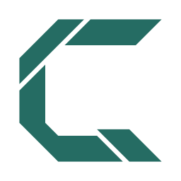
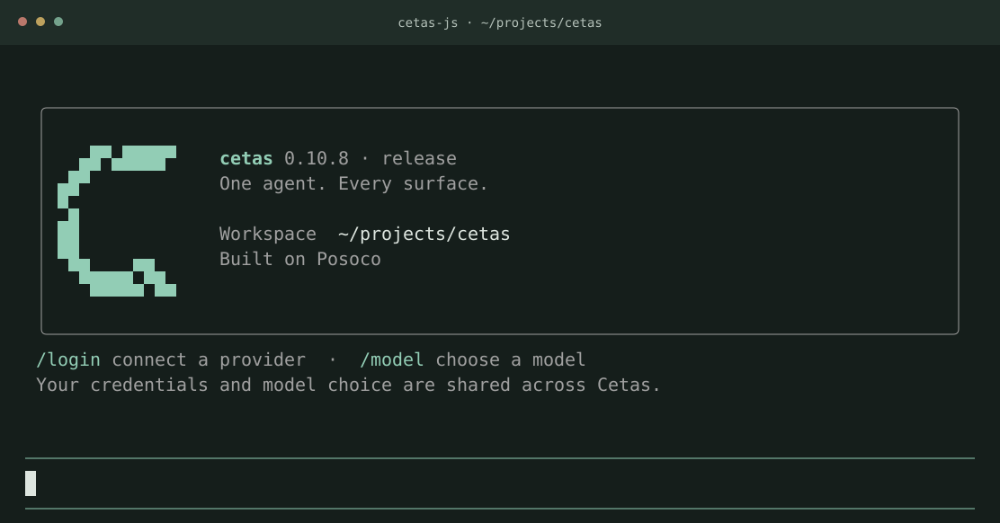

<div align="center">
  <picture>
    <source media="(prefers-color-scheme: dark)" srcset="docs/assets/cetas-symbol-dark.svg">
    
  </picture>
  <h1>Cetas</h1>
  <p><strong>One agent. Every surface.</strong></p>
  <p>A coding agent for your terminal, editor, and scripts.<br>Built with MoonBit. Powered by <a href="https://github.com/colmugx/posoco">Posoco</a>.</p>
  <p>
    <a href="https://github.com/colmugx/cetas/actions/workflows/ci.yml"></a>
    <a href="LICENSE"></a>
    <a href="https://www.moonbitlang.com"></a>
  </p>
  <p><a href="https://github.com/colmugx/cetas/releases">Download</a> · <a href="https://colmugx.github.io/cetas/">Docs</a> · <a href="#quick-start">Quick start</a> · <a href="#documentation">Documentation</a> · <a href="README-zh.md">简体中文</a></p>
</div>



<p align="center"><sub>The <code>cetas-js</code> welcome screen on main. Release binaries may have an earlier UI.</sub></p>

Cetas reads your code, makes edits, runs commands, and streams its work as it goes. Start in the terminal, connect it to an editor through ACP, or give it a single task from a script.

The product lives in **`cetas-core`**. Its hosts compose the same agent identity, prompts, and lifecycle on [Posoco](https://github.com/colmugx/posoco), with adapters for each surface. Provider settings, credentials, and session storage use a shared Cetas home.

## Why Cetas

- **Work with the repository.** Read, write, and edit files; search by path, text, or syntax; run Bash or PowerShell commands.
- **Choose your model.** Provider extensions include OpenAI, OpenAI-compatible endpoints, DeepSeek, Kimi, OpenRouter, Z.ai, and OpenCode Zen. Use `/login` and `/model` in the interactive terminal.
- **Extend the workflow.** Load skills and connect MCP tools in the interactive terminal and ACP host. Capability composition is explicit and recipe-driven.
- **Keep the conversation useful.** Stream responses and tool activity, queue follow-ups, browse sessions, and rewind in `cetas-js`.
- **Use the right entrance.** An interactive TUI for day-to-day work, ACP for editors, and a one-turn runner for automation.

## Quick start

### 1. Choose a terminal host

**Recommended — Cetas JS.** The npm distribution is the primary interactive terminal, with the broadest current feature set (including JS-only integrations such as Board workflows). Requires Node.js 24+:

```bash
npm install -g @posoco/cetas
cetas --version
```

**Alternative — Cetas Native.** A separately distributed Go/Bubble Tea v2 terminal running the same MoonBit Cetas/Posoco core. It does not require Node.js or Bun, and it is not guaranteed to have every JS feature.

| Platform | Package manager | Direct installation |
| --- | --- | --- |
| macOS · Apple Silicon | `brew install colmugx/tap/cetas` | [install.sh](install.sh) or [Cetas releases](https://github.com/colmugx/cetas/releases) |
| Linux · x64 | `brew install colmugx/tap/cetas` | [install.sh](install.sh) or [Cetas releases](https://github.com/colmugx/cetas/releases) |
| Windows · x64 | [Scoop bucket](https://github.com/colmugx/scoop-bucket) | [install.ps1](install.ps1) or [Cetas releases](https://github.com/colmugx/cetas/releases) |

```powershell
scoop bucket add cetas https://github.com/colmugx/scoop-bucket
scoop install cetas/cetas
```

The direct installers show the system, version, destination, and files before asking for confirmation. Windows Native requires `cetas_moon.dll` **beside** `cetas.exe`; the official ZIP and Scoop retain this layout. Native installation also supplies `cetas-acp` and `cetas-run`.

**Only need ACP or Run?** Download the separate `cetas-acp-{platform}` or `cetas-run-{platform}` archives from a [Cetas-tagged release](https://github.com/colmugx/cetas/releases) (for example, to run ACP with Lody). You do **not** need the whole Native terminal.

Both JS and Native use the command `cetas`; the first match on `PATH` wins. Check `command -v cetas` (or `Get-Command cetas` in PowerShell) after installing both. For a detailed comparison, see [Native terminal](cetas-native/README.md) and [installation options](docs/native-package-managers.md).

### 2. Connect a model

In the terminal, run:

```text
/login
/model
```

Choose a provider, complete its authentication flow, then select a model. Settings and credentials are stored under `~/.cetas/` and reused by the other Cetas hosts.

### 3. Give Cetas a task

```text
Explain how authentication works in this repository.
```

```text
Fix the failing tests and show me what changed.
```

Use `@path` to include a file reference. `/help` lists commands and keyboard shortcuts. To select a permission mode, use `/permission readonly`, `/permission workspace_write`, `/permission interactive`, or `/permission yolo`; see the [configuration guide](docs/configuration.md) for their behavior.

## Every surface

| Surface | Best for | Entry point |
| --- | --- | --- |
| **Interactive terminal (recommended)** · `cetas-js` | Full JS terminal, model/login pickers, sessions, rewind and JS-only integrations | `npm install -g @posoco/cetas` · [Build from source](docs/development.md#interactive-terminal) |
| **Editor** · `cetas-acp` | Editors with Agent Client Protocol support | `cetas-acp` · [Setup](docs/configuration.md#editor--acp) |
| **Automation** · `cetas-run` | One task per invocation, scripts and JSONL output | `cetas-run` · [Guide](cetas-run/README.mbt.md) |
| **Native terminal (alternative)** · `cetas-native` | Go/Bubble Tea v2 UI backed by MoonBit; no Node.js required | `brew install colmugx/tap/cetas` / [Scoop](https://github.com/colmugx/scoop-bucket) · [Guide](cetas-native/README.md) |
| **Web** · `cetas-web` | Browser host under development | [Local development](cetas-web/README.md) |

Host capabilities differ; the [composition roster](composition/recipes.csv) is the source of truth. Sharing the Cetas home does not imply every host has the same UI or cross-host conversation-resume support.

<details>
<summary><strong>Run one task from a script</strong></summary>

After configuring a provider, use the runner binary from the Cetas release:

```bash
cetas-run -- "explain this repository"
cetas-run --jsonl --stream -- "summarize the changes"
cetas-run --session <id> -- "continue"
```

The normal answer goes to stdout; diagnostics and lifecycle information go to stderr. With [MoonX](https://github.com/moonbitlang/moon), you can also run the Mooncakes module:

```bash
moonx colmugx/cetas-run -- -- "explain this repository"
```

See the [runner guide](cetas-run/README.mbt.md) for the native and sandboxed Wasm targets.

</details>

## Built on Posoco

Cetas began as a way to put [Posoco](https://github.com/colmugx/posoco) into people's hands: a useful coding agent that demonstrates what a protocol-first framework can do in everyday work.

Posoco provides the agent foundation and extension ports. Cetas owns the product behavior. Each host supplies its transport and UI. That separation lets the product grow across surfaces while keeping one core identity.

## Documentation

The documentation site is published at **[colmugx.github.io/cetas](https://colmugx.github.io/cetas/)** — task-oriented guides with search, plus an [`llms.txt`](https://colmugx.github.io/cetas/llms.txt) index for agents. The repository guides below remain the source for implementation detail.

| Guide | What you will find |
| --- | --- |
| [Configuration](docs/configuration.md) | Providers, permissions, shared state, MCP and ACP setup |
| [Development](docs/development.md) | Workspace checkout, dependencies, builds and checks |
| [Native installation](cetas-native/README.md) | Alternative terminal, platform support, installers and DLL layout |
| [Homebrew / Scoop](docs/native-package-managers.md) | Native package manager setup and publishing |
| [Architecture](docs/architecture.md) | Product ownership, repository layout and extension composition |
| [Composition](composition/README.md) | Recipe vocabulary and generator workflow |
| [Changelog](CHANGELOG.md) | Cetas core release history |
| [Memoh integration](cetas-memoh/README.mbt.md) | The separately versioned Memoh runtime and its own state directory |

## Contributing

Bug reports, focused improvements, and new host integrations are welcome. [Open an issue](https://github.com/colmugx/cetas/issues) with the host, version, platform, and steps to reproduce, or send a pull request with the relevant checks from the [development guide](docs/development.md).

For capability changes, update the composition roster; for product behavior, start in `cetas-core`.

## License

[Apache 2.0](LICENSE).
